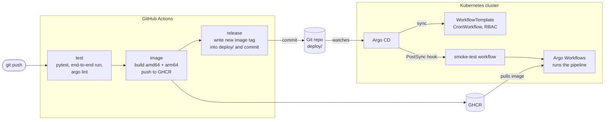
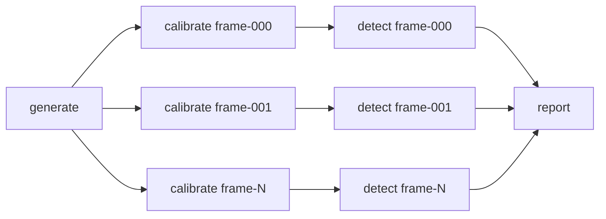

# argo-streak-detection

A small space-domain-awareness pipeline that finds satellite streaks in telescope images, run end to end the way a production data platform would be:

- **Argo Workflows** runs the image-processing pipeline on Kubernetes, one parallel branch per frame.
- **GitHub Actions** tests every change, builds a multi-arch container image and publishes it to GHCR.
- **Argo CD** deploys the pipeline from Git (GitOps) and runs a smoke test after every deployment.

A `git push` is all it takes to ship a new version of the pipeline.


*Left: a raw simulated frame with a sensor gradient, hot pixels and read noise. Right: the same frame after calibration, with 27 stars (blue) and one satellite streak (orange) detected.*

## The GitOps loop



1. **test** (every push and pull request): unit tests, a full pipeline run without Kubernetes, and `argo lint` on every manifest.
2. **image** (`main` only): builds the image for `linux/amd64` and `linux/arm64` and pushes `ghcr.io/<owner>/argo-streak-detection:sha-<commit>`.
3. **release** (`main` only): rewrites the single `image` line in `deploy/workflowtemplate.yaml` and commits it as `deploy: sha-<commit>`.
4. **Argo CD** notices the commit, applies `deploy/` to the cluster, then starts the `streak-pipeline-smoke-test` workflow. The deployment counts as healthy only if that run succeeds.

Nobody runs `kubectl apply` in production. Rolling back means reverting a commit.

## What the pipeline does



| Step | What it does | Runs |
| --- | --- | --- |
| `generate` | Simulates a batch of frames: sky noise, a fixed sensor dark pattern with hot pixels, 20–35 stars, and a faint satellite streak in about 60% of frames. Saves ground truth. | once |
| `calibrate` | Subtracts the master dark, removes the sky background and converts pixels to signal-to-noise. | once per frame, in parallel |
| `detect` | Smooths, thresholds and groups pixels, then classifies each object by shape: round → star, long and thin → streak. Measures streak angle and length from second moments. | once per frame, in parallel |
| `report` | Combines all detections and scores them against ground truth (precision, recall, angle error). | once |

The number of branches is not hard-coded: `generate` outputs the list of frames and the workflow fans out over it with `withParam`, so 12 or 500 frames use the same template.

## Results

A 12-frame run (`--seed 42`) found all 7 simulated streaks with no false alarms and a mean angle error of 1.1°. Over 4 × 100 frames (seeds 1, 2, 3, 42) it found every streak with no false alarms and a mean angle error of 0.3–0.5°. Missed stars are faint ones below the threshold or overlapping pairs.

These numbers come from simulated data, which is far cleaner than real telescope images: no cosmic rays, clouds, saturated stars, crowded fields or tracking errors. The point of this project is the pipeline, its orchestration and its delivery, not a state-of-the-art detector.

## Set it up

You need Docker, [kind](https://kind.sigs.k8s.io/), `kubectl` and a fork or copy of this repo on GitHub. Run `make help` to list every shortcut.

**1. Push the repo to GitHub.** The first CI run on `main` builds the image and commits the first `deploy:` change. Check the **Actions** tab.

**2. Make the image public.** New GHCR packages are private, so the cluster cannot pull them. On GitHub, open your profile → **Packages** → `argo-streak-detection` → **Package settings** → **Change visibility** → **Public**. This is a one-time step.

**3. Point Argo CD at your repo.** If your GitHub user is not `monstre0731`, edit `repoURL` in `argocd/application.yaml` and the image owner in `deploy/workflowtemplate.yaml`.

**4. Create a cluster and install Argo Workflows and Argo CD.**

```bash
kind create cluster --name day
make argo-install          # Argo Workflows; UI with no login, for local use only
make argocd-install        # Argo CD
make argocd-app            # start GitOps: Argo CD now manages the pipeline in the argo namespace
```

**5. Watch the first deployment.**

```bash
make argocd-password       # admin password
make argocd-ui             # https://localhost:8080 (user: admin; accept the self-signed certificate)
make argo-ui               # http://localhost:2746, in another terminal
```

In Argo CD the `streak-pipeline` app turns **Synced** and **Healthy** once the smoke test finishes. In Argo Workflows, `streak-pipeline-smoke-test` shows the full DAG.

**6. Ship a change.** Edit something visible, for example `STREAK_MIN_LENGTH` in `pipeline/detect.py`, then:

```bash
git commit -am "Tune streak length threshold" && git push
```

Within a few minutes: CI goes green, a `deploy: sha-…` commit appears, Argo CD syncs (it polls Git every 3 minutes; press **Refresh** to skip the wait) and a new smoke test runs with the new image. `make status` shows the deployed image and the latest runs.

### Other ways to run it

```bash
make run-local     # the whole pipeline in Python, no Kubernetes
make submit        # a 12-frame run with the image Argo CD deployed
make submit-local  # build your working copy, load it into kind, run it (try changes before pushing)
make logs          # report of the latest run (needs: brew install argo)
```

## Repository layout

```
pipeline/                    Python package, one module per step
  generate.py                simulate frames + ground truth
  calibrate.py               dark subtraction, background, S/N
  detect.py                  segmentation + shape classification
  report.py                  batch summary and scoring
  __main__.py                CLI: python -m pipeline <step>
tests/                       unit tests and an end-to-end run
deploy/                      everything Argo CD keeps in sync (Kustomize)
  workflowtemplate.yaml      the pipeline: DAG, fan-out, retries (image tag set by CI)
  cronworkflow.yaml          nightly run
  smoke-test.yaml            PostSync hook: verifies every deployment
  rbac.yaml                  ServiceAccount + Role for workflow pods
argocd/application.yaml      connects Argo CD to deploy/
examples/                    one-off runs (CI image or local image)
.github/workflows/ci.yaml    test → image → release
Dockerfile                   one image for every step
Makefile                     setup and everyday commands
```

## Design notes

- **One image, many steps.** Every step is a subcommand of the same image, so the Argo templates differ only in their `args`.
- **Explicit `command`.** Argo's emissary executor needs each container's command. If a template leaves it out, Argo looks the image up in a registry, which fails for an image loaded straight into kind. So every template sets `command: [python, -m, pipeline]`.
- **Dynamic parallelism.** `generate` writes the frame list to a file read as an output parameter; `withParam` creates one `calibrate → detect` DAG per frame. `parallelism: 6` caps concurrent pods.
- **Shared working volume.** Steps exchange files through a per-workflow PersistentVolumeClaim, deleted when the run ends. On kind this pins a run to one node, which is fine for a demo.
- **Immutable image tags.** Deployments reference `sha-<commit>`, never `latest`, so every running workflow can be traced to a commit.
- **Small release commits.** CI changes one line with `sed` rather than rewriting YAML, so each `deploy:` commit is a one-line diff that is easy to review and revert.
- **Deployment verified by a workflow.** The PostSync smoke test means a broken image shows up as a failed sync in Argo CD, not as a failure in the next nightly run.
- **Multi-arch images.** QEMU + Buildx build `arm64` alongside `amd64`, so the same image runs on cloud nodes and on Apple-silicon laptops.

## From demo to production

| This demo | In a production pipeline |
| --- | --- |
| Simulated frames | Real frames arriving in object storage (S3, Azure Blob), often FITS files |
| Shared volume between steps | Argo artifacts in object storage, so steps can run on any node |
| Classical thresholding | A trained detector on GPU nodes (`nodeSelector` + `tolerations`, commented in the template) |
| Runs started by hand or by cron | Started by events, e.g. new files in a bucket via Argo Events |
| Public image, no login on the Argo UI | Private registry with pull secrets, SSO on Argo CD and Argo Workflows |
| One cluster | Separate dev and prod, promoted by moving the image tag through Git |
| Logs in the pod | Centralised logs and metrics (Elasticsearch, Prometheus, Grafana) |

## Next steps

- Pass files between steps as S3 artifacts (MinIO locally) instead of a shared volume
- Make the simulation harder: cosmic rays, crowded fields, varying seeing, faster and fainter satellites
- Link streaks across consecutive frames and fit a simple orbit
- Add a staging environment and promote releases with a pull request

## License

MIT
