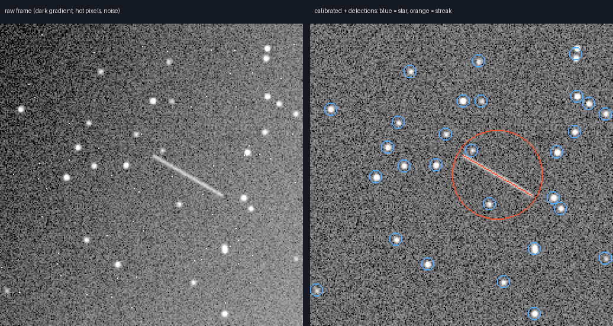
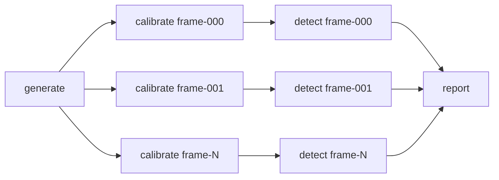

# argo-streak-detection

A small space-domain-awareness pipeline that finds satellite streaks in telescope images, orchestrated with **Argo Workflows** on **Kubernetes**.

Each batch of frames is calibrated and searched for objects **in parallel**, one branch per frame, then combined into a single report scored against ground truth.



*Left: a raw simulated frame with a sensor gradient, hot pixels and read noise. Right: the same frame after calibration, with 27 stars (blue) and one satellite streak (orange) detected.*

## What the pipeline does

| Step | What it does | Runs |
| --- | --- | --- |
| `generate` | Simulates a batch of frames: sky noise, a fixed sensor dark pattern with hot pixels, 20–35 stars, and a faint satellite streak in about 60% of frames. Saves ground truth. | once |
| `calibrate` | Subtracts the master dark, removes the sky background and converts pixels to signal-to-noise. | once per frame, in parallel |
| `detect` | Smooths, thresholds and groups pixels, then classifies each object by shape: round → star, long and thin → streak. Measures streak angle and length from second moments. | once per frame, in parallel |
| `report` | Combines all detections and scores them against ground truth (precision, recall, angle error). | once |



The number of branches is not hard-coded. `generate` outputs the list of frames, and the workflow fans out over it with `withParam`, so a batch of 12 or 500 frames uses the same template.

## Results

A 12-frame run (`--seed 42`):

| Frame | Streak in truth | Streak found | Angle error (deg) | Stars found / simulated |
| --- | --- | --- | --- | --- |
| frame-000 | no | no |  | 20 / 21 |
| frame-001 | yes | yes | 0.0 | 28 / 30 |
| frame-002 | no | no |  | 22 / 23 |
| frame-003 | yes | yes | 0.1 | 29 / 32 |
| frame-004 | yes | yes | 3.6 | 23 / 26 |
| frame-005 | yes | yes | 0.0 | 24 / 24 |
| frame-006 | yes | yes | 3.1 | 27 / 30 |
| frame-007 | no | no |  | 27 / 27 |
| frame-008 | yes | yes | 0.9 | 24 / 26 |
| frame-009 | yes | yes | 0.2 | 32 / 32 |
| frame-010 | no | no |  | 31 / 33 |
| frame-011 | no | no |  | 25 / 27 |

Streak precision 1.0, recall 1.0, mean angle error 1.1°. Over 4 × 100 frames (seeds 1, 2, 3, 42) the detector found every streak with no false alarms and a mean angle error of 0.3–0.5°. Missed stars are faint ones below the threshold or pairs that overlap.

These numbers come from simulated data, which is far cleaner than real telescope images: there are no cosmic rays, clouds, saturated stars, crowded fields or tracking errors. The point of this project is the pipeline and its orchestration, not a state-of-the-art detector.

## Run it locally (no Kubernetes)

```bash
pip install -r requirements.txt pytest
python -m pytest -q
python -m pipeline --data-dir ./out run-local --n-frames 12 --seed 42
cat out/report.md
```

Preview images of every frame are written to `out/raw/*.png`.

## Run it on Kubernetes with Argo Workflows

Set up for a local [kind](https://kind.sigs.k8s.io/) cluster on macOS with Docker Desktop.

**1. Install Argo Workflows** (skip if already installed)

```bash
kubectl create namespace argo
kubectl apply -n argo --server-side --force-conflicts \
  -f https://github.com/argoproj/argo-workflows/releases/latest/download/install.yaml
```

`--server-side` is needed: the Argo CRDs are too large for a client-side apply.

**2. Build the image and load it into kind** (no registry needed)

```bash
make kind-load          # docker build + kind load docker-image
```

**3. Install the permissions and the WorkflowTemplate**

```bash
make deploy
```

**4. Run the pipeline**

```bash
make submit             # or: argo submit -n argo --from workflowtemplate/streak-pipeline -p n-frames=40 --watch
make watch              # step pods appear, run and complete
make logs               # report of the latest run
```

**5. See it in the Argo UI**

```bash
make ui                 # then open http://localhost:2746
```

The UI shows the DAG: one `generate` node, a fan-out of `calibrate → detect` pairs, and `report` at the end.

A nightly schedule is included in `k8s/cronworkflow.yaml`.

## Repository layout

```
pipeline/                 Python package, one module per step
  generate.py             simulate frames + ground truth
  calibrate.py            dark subtraction, background, S/N
  detect.py               segmentation + shape classification
  report.py               batch summary and scoring
  __main__.py             CLI: python -m pipeline <step>
tests/                    unit tests and an end-to-end run
k8s/
  rbac.yaml               ServiceAccount + Role for workflow pods
  workflowtemplate.yaml   the pipeline definition (DAG, fan-out, retries)
  workflow.yaml           one run of the template
  cronworkflow.yaml       optional nightly schedule
Dockerfile                one image for every step
Makefile                  build, deploy, run
.github/workflows/ci.yaml tests, end-to-end run, image build to GHCR
```

## Design notes

- **One image, many steps.** Every step is a subcommand of the same image, so the Argo templates differ only in their `args`.
- **Dynamic parallelism.** `generate` writes the frame list to a file that Argo reads as an output parameter; `withParam` creates one `process-frame` DAG per item. `parallelism: 6` caps how many step pods run at once.
- **Shared working volume.** Steps exchange files through a per-workflow PersistentVolumeClaim (`volumeClaimTemplates`), deleted when the run finishes. On kind the local-path volume pins every step to one node, which is fine for a demo.
- **Retries.** `detect` retries up to twice on failure.
- **Clean stdout.** Steps log to stderr, so stdout only carries machine-readable output.

## From demo to production

| This demo | In a production pipeline |
| --- | --- |
| Simulated frames | Real frames arriving in object storage (S3, Azure Blob), often FITS files |
| Shared volume between steps | Argo artifacts backed by object storage, so steps can run on any node |
| Classical thresholding | A trained detector running on GPU nodes (`nodeSelector` + `tolerations`, commented in the template) |
| `kubectl create` by hand | An event (new files in a bucket) triggers the run, e.g. via Argo Events |
| `make deploy` | Argo CD syncs the templates from Git |
| Logs in the pod | Centralised logs and metrics (Elasticsearch, Prometheus, Grafana) |

## Next steps

- Pass files between steps as S3 artifacts (MinIO locally) instead of a shared volume
- Make the simulation harder: cosmic rays, crowded fields, varying seeing, faster and fainter satellites
- Link streaks across consecutive frames and fit a simple orbit
- Deploy the WorkflowTemplate with Argo CD

## License

MIT
